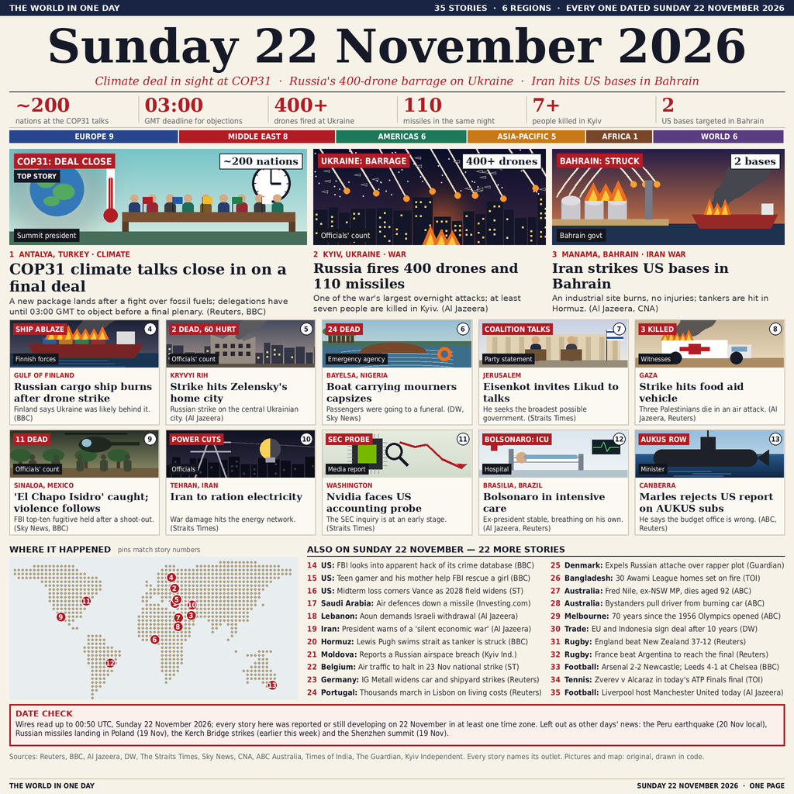

# The World in One Day: Sunday 22 November 2026

One illustrated front page for Sunday 22 November 2026: 35 stories in 6 regions. It has three lead scenes
(COP31 close to a deal in Antalya, Russia's 400-drone and 110-missile barrage on Ukraine, Iran's strikes on US
bases in Bahrain), ten picture cards and a numbered map. It ends with an "Also on Sunday" list and a date check
that says which stories were left out because they belong to other days. Every card shows a red keyword tag
and a source chip, and names its outlet.

- `tools/build.py` draws the page with Pillow at 2x and scales it down to 1024 x 1024. Scenes and map are original art drawn in code.
- `main.py` copies `assets/entry.png` to `$MAKEFUN_OUTPUT_DIR` (default `/output`), using only the standard library.

Facts come from RSS items by Reuters, BBC, Al Jazeera, DW, The Straits Times, Sky News, CNA, ABC Australia,
Times of India, The Guardian and Kyiv Independent. Each item used is dated 22 November 2026 in at least one time zone.

Built for the [make.fun](https://make.fun/bounty/news-image-20261122) bounty. Join make.fun with referral code `rv7zbbj2`: https://make.fun/?ref=rv7zbbj2

MIT licensed.
